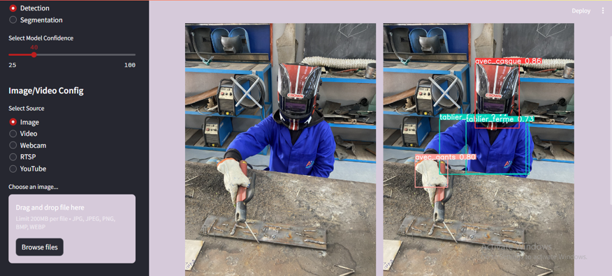

# Ergonomie 4.0 — PPE & posture detection in a welding workshop

Computer-vision system that checks, in real time, whether welding operators wear their
**personal protective equipment (PPE / EPI)** and whether their **posture** is ergonomic.

Academic project — ENSAM Meknès (Université Moulay Ismail), Industrial Engineering.



## Features

- **PPE detection** with a custom **YOLOv8s** model trained on our own photos of the
  ENSAM welding workshop (11 classes: helmet, gloves, apron, shoes, accessories, hair).
- **Compliance alert**: the app flags every rule that is not respected
  (no helmet, no gloves, open apron, unsuitable shoes…).
- **Posture evaluation** with **MediaPipe Pose**: trunk, neck and leg angles,
  coloured green / yellow / red according to ergonomic thresholds.
- Sources: **image upload, video files, webcam, RTSP camera**.
- Optional object **tracking** (ByteTrack / BoT-SORT) on video streams.

## Results

YOLOv8s trained from scratch for 200 epochs (640×640), evaluated on held-out images:

| Split | Images | mAP50 | mAP50-95 | Precision | Recall |
|-------|-------:|------:|---------:|----------:|-------:|
| Validation | 93 | 0.771 | 0.372 | 0.707 | 0.758 |
| Test       | 47 | **0.809** | 0.396 | 0.857 | 0.707 |

Per-class AP50 on the test split:

| Class | Meaning | AP50 |
|-------|---------|-----:|
| `avec_casque` | helmet worn | 0.954 |
| `sans_casque` | no helmet | 0.905 |
| `avec_gants` | gloves worn | 0.700 |
| `sans_gants` | no gloves | 0.898 |
| `tablier_ferme` | apron closed | 0.737 |
| `tablier_ouvert` | apron open | 0.893 |
| `sans_tablier` | no apron | 0.995 |
| `chaussure_adequat` | suitable shoes | 0.630 |
| `chaussure_inadequat` | unsuitable shoes | 0.695 |
| `presence_accessoires` | accessories worn | 0.534 |
| `presence_cheveux` | hair not covered | 0.962 |

Reproduce with `python train.py --evaluate` (requires the dataset, see below).

## Quick start

Python 3.9 – 3.12 (tested with 3.11).

```bash
git clone https://github.com/<your-user>/ergonomie-4.0.git
cd ergonomie-4.0
python -m venv .venv
.venv\Scripts\activate          # Windows  (Linux/macOS: source .venv/bin/activate)
pip install -r requirements.txt
streamlit run app.py
```

The app opens at <http://localhost:8501>.

1. Choose what to analyse: **PPE detection**, **Posture**, or both.
2. Pick a source: upload an image, choose a video from `videos/`, or start the webcam.
3. Adjust the confidence threshold if needed (default 0.40).

Posture can also run in a plain OpenCV window: `python posture.py` (Esc to quit).

## Project structure

```
ergonomie-4.0/
├── app.py            # Streamlit interface
├── helper.py         # model loading, frame processing, video/webcam/RTSP players
├── posture.py        # MediaPipe posture evaluation (trunk / neck / leg angles)
├── settings.py       # paths, sources, non-compliant PPE classes
├── train.py          # train or evaluate the detector
├── weights/best.pt   # trained YOLOv8s PPE detector
├── dataset/          # soudage_ia dataset (YOLOv8 format) — see dataset/README.md
├── images/           # example images shown by the app
├── videos/           # demo video(s); any .mp4 dropped here appears in the app
└── docs/             # screenshots
```

## Dataset

**soudage_ia v2** — 1,118 annotated images (978 train / 93 valid / 47 test) taken in the
ENSAM welding workshop, annotated with Roboflow. Training images were augmented ×3
(random crop 0–20 %, brightness and exposure ±25 %), resized to 640×640.
See [dataset/README.md](dataset/README.md).

## Training

GPU recommended (e.g. Google Colab):

```bash
python train.py --epochs 200 --model yolov8s.yaml
```

Then copy `runs/ppe*/weights/best.pt` to `weights/best.pt`.

## Limitations

- Small dataset from a single workshop: performance will drop with other lighting,
  clothing or camera angles.
- Weakest classes: accessories (AP50 0.53) and shoes (0.63–0.70), which are small objects.
- Posture angles come from a single camera and are an indicator, not a certified
  ergonomic assessment (RULA/REBA).

## Authors

- **Ayoub Elkhader** — ENSAM Meknès
- **Chaimae Boualam** — ENSAM Meknès

## Acknowledgements

- Interface adapted from
  [CodingMantras/yolov8-streamlit-detection-tracking](https://github.com/CodingMantras/yolov8-streamlit-detection-tracking).
- [Ultralytics YOLOv8](https://github.com/ultralytics/ultralytics),
  [MediaPipe](https://github.com/google-ai-edge/mediapipe),
  [Streamlit](https://streamlit.io), [Roboflow](https://roboflow.com).

## License

[AGPL-3.0](LICENSE), as required by the Ultralytics YOLOv8 library this project builds on.
