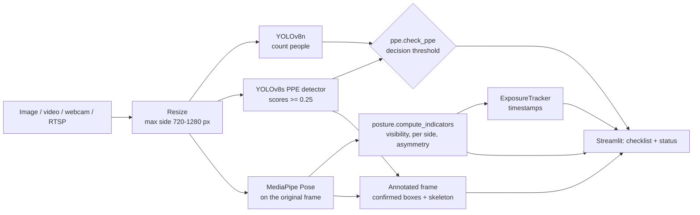

# Ergonomie 4.0

**Computer-vision prototype for PPE detection and exploratory posture indicators in a welding workshop.**

Academic project — ENSAM Meknès (Moulay Ismail University), Industrial Engineering.

> The dataset class names are in French, as annotated (e.g. `avec_casque` = helmet
> worn, `sans_gants` = no gloves); their English meaning is given in
> [dataset/README.md](dataset/README.md).


> **Status: research prototype.** It supports a human safety check; it does not
> certify PPE compliance and it is not a validated ergonomic assessment
> (no RULA / REBA score). See [Limitations](#limitations).

## Problem and audience

In a welding workshop, operators must wear a welding helmet, gloves, a closed
apron and safety shoes, and must not wear jewellery or leave hair uncovered.
Welding is also done in sustained, often bent postures. Checking this by eye is
intermittent. This prototype explores how far a single camera can help a
**trainer, safety officer or industrial-engineering student** to spot missing
equipment and awkward postures, and where it fails.

## What it does

| Function | How | Output |
|---|---|---|
| PPE detection | YOLOv8s trained by the authors on 1,118 workshop images, 11 classes | boxes for helmet / gloves / apron / shoes worn or missing, hair, accessories |
| PPE checklist for **one** operator | rule in [`ppe.py`](ppe.py) | *anomaly detected*, *no anomaly detected among the observed items*, or *evaluation incomplete* |
| People count | COCO YOLOv8n, class *person* | flags images with 0 or several people (out of scope) |
| Posture indicators | MediaPipe Pose, geometry in [`posture.py`](posture.py) | trunk inclination, neck / hip / knee flexion per side, with exploratory thresholds |
| Exposure duration (video) | video timestamps or wall clock | seconds spent above each threshold — a duration, not a risk score |

Sources: image upload, video files (`videos/`), webcam, RTSP camera.

## Architecture



| File | Role |
|---|---|
| `app.py` | Streamlit interface |
| `helper.py` | model loading, frame pipeline, reports, video players |
| `ppe.py` | PPE decision rule (pure Python, unit-tested) |
| `posture.py` | posture indicators, overlay, exposure tracker (unit-tested) |
| `settings.py` | paths, thresholds, checklist, posture parameters |
| `train.py` | training (scratch or pretrained) with validation-only selection |
| `scripts/audit_dataset.py` | dataset statistics and leakage checks |
| `scripts/evaluate.py` | reproducible evaluation with fingerprints and plots |
| `scripts/benchmark.py` | speed measurement |
| `tests/` | decision and geometry tests |

## PPE decision rule

A detection counts as **confirmed** evidence if its detector score is ≥ the
decision threshold (default 0.50, slider in the app), as **uncertain** between
0.25 and that threshold, and is ignored below 0.25. Detector scores are not
probabilities of compliance.

Each required item (helmet, gloves, apron, safety shoes) is:

| Status | Condition |
|---|---|
| ✅ worn | confirmed "worn" detection and no "missing" detection |
| ❌ missing | confirmed "missing / badly worn" detection (e.g. `sans_gants`, `tablier_ouvert`) |
| ⚠️ uncertain | only low-score evidence, a weak contrary detection, or conflicting confirmed detections |
| ❔ not observed | no detection at all — out of view, hidden or missed. **Never assumed worn.** |

Overall status:

- **Anomaly detected** — at least one item *missing*, or a confirmed hazard
  (uncovered hair, accessories);
- **No anomaly detected among the observed items** — all four items *worn*,
  nothing uncertain, exactly one person in the image;
- **Evaluation incomplete** — every other case, including 0 or several people.
  Equipment is not associated with individual people, so the decision is only
  supported for one operator per image.

Example: an image where only a helmet is detected gives *evaluation incomplete*
(gloves, apron and shoes *not observed*) — see `tests/test_ppe.py`.

## Posture indicators

Defined in [`posture.py`](posture.py), computed separately for the left and right side:

| Indicator | Definition | Reference frame | Used for the level |
|---|---|---|---|
| Trunk inclination | angle between hip→shoulder and the **upward vertical of the image** | 2D image | yes |
| Neck flexion | angle between shoulder→ear and hip→shoulder (0 = aligned) | 3D, body segments | yes |
| Hip flexion | 180° − angle shoulder-hip-knee (thigh–torso; standing 0°, seated ≈ 90°) | 3D, body segments | information |
| Knee flexion | 180° − angle hip-knee-ankle | 3D, body segments | information |

Assumptions and limits:

- **Trunk inclination equals inclination to gravity only if the camera is level
  (no roll or pitch) and the operator is seen from the side.** No calibration is
  applied: a tilted camera biases the value by its tilt; a front view hides
  forward bending. The angle is unsigned (leaning back also counts).
  A calibrated vertical (level, IMU, or a plumb reference in the scene) would be
  needed for a true gravity reference.
- 3D angles between segments use MediaPipe world landmarks, whose depth from a
  single image is approximate.
- A side is used only if all its points have MediaPipe visibility ≥ 0.5;
  otherwise it is *unavailable*. With both sides, the larger value is used and
  a left/right difference > 15° is shown as an asymmetry. With no usable side:
  *measurement unavailable*.
- MediaPipe tracks one person; with several people the measured person is unknown.

Thresholds (`settings.POSTURE_THRESHOLDS`) are **exploratory and configurable**:
trunk 20° / 60°, neck 10° / 20°, hip 45° / 90°, knee 30° / 60°. The trunk and neck
limits reuse the angle bands of RULA (McAtamney & Corlett, *Applied Ergonomics*
24(2), 1993) for orientation only — the quantities measured here differ from the
RULA observations and **no RULA/REBA score is computed**.

The original version measured "trunk" as the thigh–torso angle; it gave 0° for
a whole body tilted 45° and 90° for an upright seated operator. That quantity is
now reported as *hip flexion*, and *trunk inclination* is a separate indicator.

## Installation

Verified on Windows 10 with Python 3.11 (see [docs/VERIFICATION.md](docs/VERIFICATION.md)
for the exact versions and the clean-environment install test).

```bash
git clone https://github.com/ayoub-elkhader/ergonomie-4.0.git
cd ergonomie-4.0
python -m venv .venv
.venv\Scripts\activate          # Windows  (Linux/macOS: source .venv/bin/activate)
pip install -r requirements.txt
streamlit run app.py
```

`mediapipe==0.10.14` is pinned because later releases removed the
`mp.solutions.pose` API used here; it requires `numpy<2`.

## Usage

| Task | Command |
|---|---|
| Demo app | `streamlit run app.py` |
| Unit tests | `pip install -r requirements-dev.txt` then `pytest` |
| Dataset audit | `python scripts/audit_dataset.py` → `reports/dataset_audit.md` |
| Evaluation | `python scripts/evaluate.py --splits val test` → `reports/evaluation/` |
| Speed benchmark | `python scripts/benchmark.py` → `reports/benchmark.md` |
| Training | `python train.py --model yolov8s.yaml --epochs 200` (see `train.py` for the pretrained comparison protocol) |

The audit, evaluation and training need the dataset images (see [Data](#data)).

## Results (reproduced)

Model `weights/best.pt`: YOLOv8s trained **from scratch** (no pretrained
weights), 200 epochs, 640 px, seed 0, saved 2024-01-31 with Ultralytics 8.0.20.
No training log was kept. The figures below were re-computed on 2026-11-04 with
`python scripts/evaluate.py --splits val test --device cpu` (Ultralytics 8.4.202);
full report with per-class supports, confusion matrices and curves:
[`reports/evaluation/evaluation.md`](reports/evaluation/evaluation.md).

| Split | Images | Instances | Precision | Recall | mAP50 | mAP50-95 |
|---|--:|--:|--:|--:|--:|--:|
| Validation | 93 | 359 | 0.707 | 0.758 | 0.771 | 0.372 |
| Test | 47 | 204 | 0.857 | 0.707 | 0.809 | 0.396 |

Precision and recall are class means at the F1-optimal threshold chosen by
Ultralytics; mAP summarises detection quality over all thresholds. **None of
these is a percentage of correct compliance decisions.**

At the app threshold (score ≥ 0.50, IoU ≥ 0.5), test split, non-compliance classes:

| Class | Test instances | TP / FP / FN | Precision | Recall |
|---|--:|--:|--:|--:|
| sans_casque | 11 | 9 / 0 / 2 | 1.00 | 0.82 |
| sans_gants | 10 | 8 / 0 / 2 | 1.00 | 0.80 |
| tablier_ouvert ⚠️ | 7 | 2 / 0 / 5 | 1.00 | 0.29 |
| chaussure_inadequat ⚠️ | 8 | 4 / 1 / 4 | 0.80 | 0.50 |
| sans_tablier ⚠️ | 1 | 1 / 0 / 0 | 1.00 | 1.00 |
| presence_cheveux ⚠️ | 5 | 3 / 0 / 2 | 1.00 | 0.60 |
| presence_accessoires ⚠️ | 4 | 0 / 0 / 4 | – | 0.00 |

⚠️ fewer than 10 test instances: these figures can change completely with a
few more images. With one `sans_tablier` instance nothing can be concluded.

**Decision level** (rule applied to the predictions vs. to the ground-truth
labels, test split, 47 images): of the 21 images whose labels contain an
anomaly, 13 are reported as *anomaly* and 8 as *incomplete*; none is reported
as *no anomaly*. On the validation split, 1 of 40 such images is reported as
*no anomaly* (a missed anomaly). Labels are per image and may mix several people,
so this is an indication, not a validation of the decision.

**These scores are probably optimistic**: the dataset was split photo by photo,
and near-identical photos of the same person and session appear in train and
test (see [dataset/README.md](dataset/README.md)). They describe performance in
this workshop with these people, not on new sites.

### Speed

Measured with `python scripts/benchmark.py` on an Intel Core i7-5600U laptop CPU
(2 cores, 2015), no GPU, 400×720 frames, YOLO at 640 px
([`reports/benchmark.md`](reports/benchmark.md)):

| Stage | median ms / frame | frames / s |
|---|--:|--:|
| PPE detector (YOLOv8s) | 288 | 3.5 |
| Person counter (YOLOv8n) | 109 | 9.2 |
| Pose (MediaPipe) | 34 | 29.2 |
| Full pipeline | 424 | 2.4 |

The full pipeline is **not real-time on this hardware** (≈ 2.4 frames/s before
display). A GPU or a smaller detector would be needed; this has not been measured.

## Limitations

- **One operator per image.** Equipment is not attributed to individuals; images
  with 0 or several people are reported as incomplete.
- **Small, single-site dataset**: 326 distinct training photos, one workshop,
  a few people; non-independent splits; strong class imbalance (ratio 23).
- **Weak classes**: accessories (missed on the test set), open apron, shoes
  (small, often hidden under tables).
- **Hidden equipment is never inferred**: seated operators behind a bench are
  usually *incomplete* (shoes not observed).
- **Posture**: single uncalibrated camera; trunk inclination needs a level
  camera and a side view; MediaPipe often fails on helmets, hoods and
  occluded bodies; no RULA/REBA score; thresholds are exploratory.
- **Exposure durations** are times above thresholds, not a risk score.
- **Not real-time** on a laptop CPU (see Speed).
- Not tested on a real webcam or RTSP camera in the workshop.

## Data

The soudage_ia images are **not published** (private Roboflow project, photos
of identifiable people, no documented consent). Without them you can run the
app and the unit tests; the audit, evaluation and training require the data.
Authorised members of the Roboflow project can export version 2 in YOLOv8
format into `dataset/` (see [dataset/README.md](dataset/README.md)); the split
fingerprints recorded in `reports/evaluation/evaluation.md` let you check you
have exactly the same data.

## Media and privacy

`images/epi1.jpg`, `images/epi1cor.jpg`, `docs/interface.png` and
`videos/demo_atelier.mp4` show people in the workshop. Their publication
consent is not documented in this repository; replace or anonymise them if it
cannot be confirmed.

## Authors

- **Ayoub Elkhader** — ENSAM Meknès
- **Chaimae Boualam** — ENSAM Meknès

*Individual contributions: to be completed by the authors.*

## Acknowledgements and license

- Interface adapted from
  [CodingMantras/yolov8-streamlit-detection-tracking](https://github.com/CodingMantras/yolov8-streamlit-detection-tracking)
  (Apache-2.0).
- [Ultralytics YOLOv8](https://github.com/ultralytics/ultralytics),
  [MediaPipe](https://github.com/google-ai-edge/mediapipe),
  [Streamlit](https://streamlit.io), [Roboflow](https://roboflow.com).

License: [AGPL-3.0](LICENSE), as required by Ultralytics YOLOv8.
Third-party notices: [NOTICE](NOTICE).
